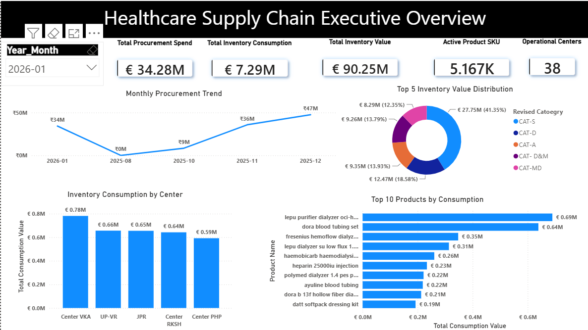
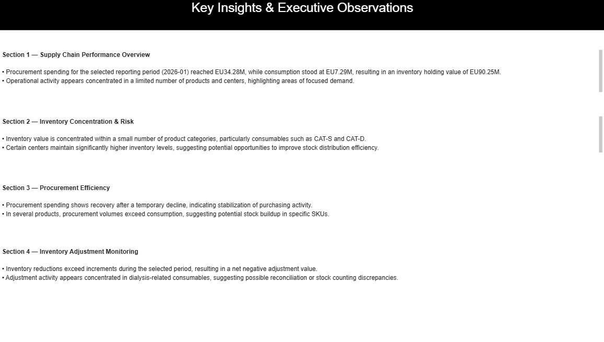
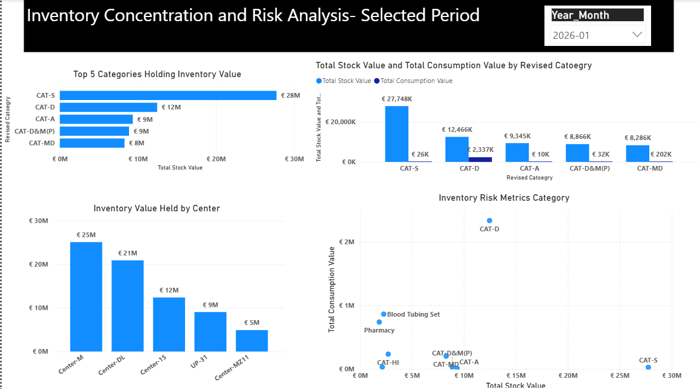
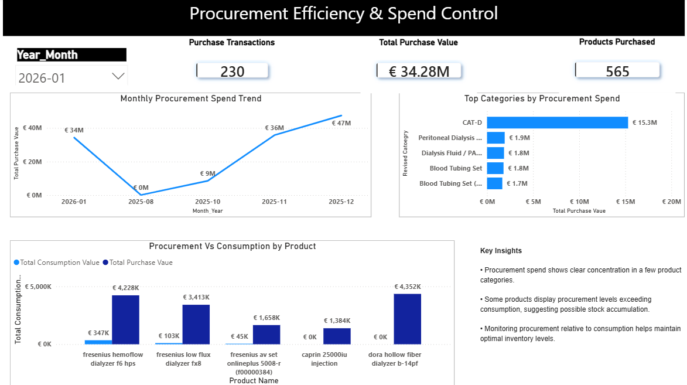
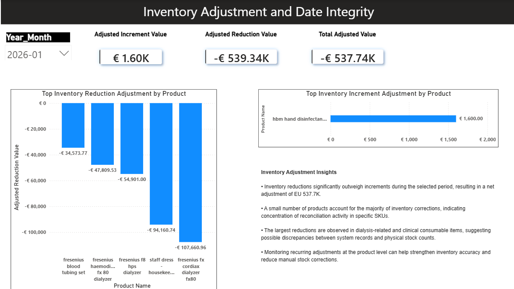
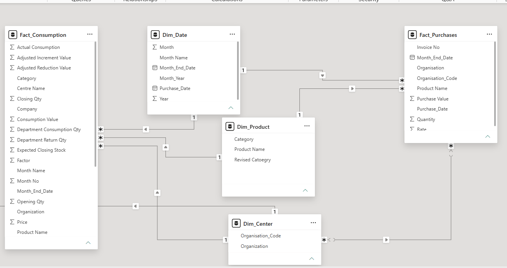

# 🏥 Enterprise Healthcare Supply Chain & Clinical Inventory Analytics

An end-to-end Power BI executive analytics solution engineered using Power Query (M) transformations and star-schema data modeling. Built to monitor procurement efficiency, optimize €90M+ in clinical stock holding risk, and detect inventory discrepancies across 38 operational centers.

---

## 📊 Executive Reporting Command Center

### 1. Executive Summary Overview
High-level KPI tracking showing **€34.28M Total Procurement Spend**, **€7.29M Inventory Consumption**, and **€90.25M Total Inventory Value** across 38 operational centers.

### 2. Key Insights & Executive Observations
C-suite narrative summary highlighting inventory risk, spend recovery trends, and net stock adjustment flags.

### 3. Inventory Risk & Concentration Analysis
Multi-center holding risk analysis breaking down category distribution (CAT-S holding €27.75M / 41.35%) and center-level stock valuation.

### 4. Procurement vs. Consumption Efficiency
Tracking purchasing trends (€47.45M total purchases across 565 SKUs) against actual consumption rates to prevent stock accumulation.

### 5. Stock Adjustment & Discrepancy Monitoring
Audit tracking identifying **€-537.74K Net Negative Stock Adjustments**, driven primarily by dialysis consumables and clinical items.

---

## 🏗️ Data Architecture & Star Schema Model

### Star Schema Data Model

[Multi-Source Operational Data]
│
▼
[Power Query (M Code) Transformation Engine]
├── Currency & Regional Standardisation (EUR €)
├── Data Sanitization & String Trimming
└── Attribute Normalization
│
▼
[Star Schema Data Model]
├── Fact Tables: Fact_Consumption, Fact_Purchases
└── Dim Tables: Dim_Product, Dim_Center, Dim_Date, Cateogry

---

## 🛠️ Technical Implementation Highlights

* **Power Query ETL (`Fact_Queries_ETL.m` & `Dimension_Queries_ETL.m`):** Handled multi-table transformations, text cleaning, custom conditional columns, and data type enforcement across raw operational files.
* **Data Modeling:** Built an enterprise star schema establishing 1-to-many relationships to ensure high-performance DAX filtering across center and date hierarchies.
* **DAX Analytics:** Engineered measures for period-over-period spend trends, consumption variances, and inventory valuation metrics.

---

## 💡 Key Business Impact

1. **Capital Optimization:** Identified that **41.35% of total stock value** (€27.75M) was locked in a single product category, enabling targeted inventory reduction strategies.
2. **Loss Prevention:** Uncovered **€537.74K in net negative inventory adjustments**, isolating clinical consumable discrepancies (e.g., dialysis tubing sets) for audit review.
3. **Purchasing Alignment:** Evaluated procurement spend against actual usage patterns to mitigate over-purchasing across distribution centers.
A fully optimized star schema separating high-volume transaction facts (`Fact_Consumption`, `Fact_Purchases`) from core lookup dimensions (`Dim_Product`, `Dim_Center`, `Dim_Date`).

